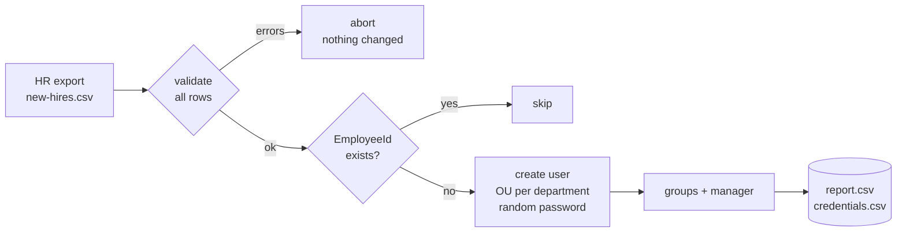

# ad-user-provisioning

PowerShell module for joiner/leaver processes in Active Directory: new employees are created
from an HR CSV export, leavers are offboarded in a traceable way. Built so that it is safe to run
on a real domain: validation before any change, `-WhatIf` everywhere, idempotent, with reports.



## Onboarding

```powershell
Import-Module .\src\ADProvisioning
Invoke-UserOnboarding -Path .\samples\new-hires.csv -ConfigPath .\config\provisioning.json -WhatIf
Invoke-UserOnboarding -Path .\samples\new-hires.csv -ConfigPath .\config\provisioning.json
```

| CSV column | Required | Notes |
|---|---|---|
| `EmployeeId` | yes | 4-10 digits, stored in `employeeID`, used to detect existing users |
| `GivenName`, `Surname` | yes | umlauts and accents handled (`Jürg Müller` → `juerg.mueller`) |
| `Department` | yes | must exist in `config/provisioning.json`, decides OU and groups |
| `Title`, `Manager`, `StartDate` | no | manager as sAMAccountName, date as `yyyy-MM-dd` |

- Account names follow `firstname.lastname`, max. 20 characters, collisions get `2`, `3`, ...
- Initial passwords are cryptographically random, meet AD complexity, avoid look-alike characters
  and must be changed at first logon. They go into a separate `credentials-*.csv` that only the
  current user can read, never into the report or the log.

## Offboarding

```powershell
Invoke-UserOffboarding -SamAccountName anna.meier -Reason 'Ticket 4711' -ConfigPath .\config\provisioning.json
Import-Csv leavers.csv | Invoke-UserOffboarding -Reason 'Q4 leavers' -ConfigPath .\config\provisioning.json
```

Disables the account, removes all group memberships (listed in the report, so access can be restored),
writes *when, who and why* into the description and moves the user to the disabled OU.
Nothing is deleted. Asks for confirmation by default (`ConfirmImpact = High`).

## Testing

- **Pester 5** tests mock the AD cmdlets, so they run anywhere: name rules, password rules, validation,
  `-WhatIf`, idempotency, batch abort, no passwords in reports, offboarding steps.
- **PSScriptAnalyzer** with zero findings, including compatibility checks for PowerShell 5.1 and 7.
- CI runs both on Linux and Windows, plus a smoke test in Windows PowerShell 5.1.
- A [test lab](lab/README.md) creates a throwaway `lab.local` domain with the expected OUs and groups.

Run locally: `./build.ps1`

## Design decisions

- **All or nothing validation.** A batch with one bad row is rejected before the first change; half-imported batches are hard to clean up.
- **EmployeeId as identity, not the name.** Names change and repeat; the HR number doesn't. Running the same file twice is safe.
- **Disable, don't delete.** Deleted accounts lose their SID, mailbox and audit trail. Offboarding keeps the account and documents it.
- **ASCII-only source files.** Windows PowerShell 5.1 reads BOM-less scripts as ANSI, which silently corrupts literal umlauts. Special characters are written as code points.

Sample data uses invented people.
